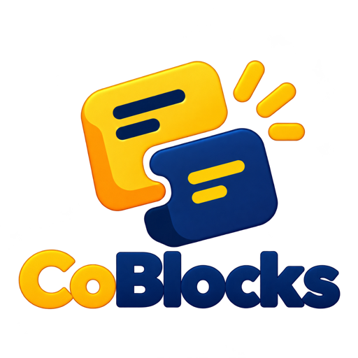

<p align="center">
  
</p>

<h1 align="center">CoBlocks</h1>

<p align="center">
  Real time collaboration for Scratch.<br>
  <sub>Previously LiveScratch</sub>
</p>

<p align="center">
  <a href="https://chromewebstore.google.com/detail/livescratch-live-scratch/pfaldlkkohfdnmlcladmhlihpbhlkolm"></a>
  <a href="https://status.uptime-monitor.io/67497373f98a6334aaea672d"></a>
  <a href="https://ko-fi.com/waakul"></a>
</p>

## Features

- Collaborate on Scratch projects in real time.
- Sign in securely with [Scratch Auth](https://auth.itinerary.eu.org/documentation/using-scratch-auth).
- Invite Scratch friends and manage project access.
- Chat with collaborators inside the Scratch editor.
- Share Scratch blocks through the project backpack.
- Keep local recovery copies to protect work when the backend is unavailable.

## Run locally

### Backend

```sh
git clone https://github.com/Waakul/CoBlocks.git
cd CoBlocks/backend
npm install
cp .env.example .env
npm run start
```

Edit `.env` before starting the server. Set `PUBLIC_BASE_URL` to the public origin that Scratch Auth should return to. For local extension testing, enable **Custom Server** in the popup and enter `http://localhost:<PORT>`.

Use `npm run stop` to stop the PM2 process and `npm run delete` to remove it.

Run the quality checks before submitting backend or extension changes:

```sh
cd backend
npm run lint
npm test
```

### Extension

The same `extension` folder works in Chrome 121+, Brave, Edge, and Firefox 140+.

For Chrome, Brave, and Edge:

1. Open your browser's extensions page.
2. Enable developer mode.
3. Choose **Load unpacked** and select the `extension` folder.
4. Open Scratch and use the CoBlocks popup to sign in.

For Firefox:

1. Open `about:debugging#/runtime/this-firefox`.
2. Choose **Load Temporary Add-on** and select the same `extension/manifest.json`.
3. Allow access to Scratch and the CoBlocks API when Firefox asks, then sign in through the popup.

Temporary Firefox add-ons are removed when Firefox restarts; permanent installation requires a Mozilla-signed package.

To copy the shared package into `dist/coblocks`, run:

```sh
node scripts/build-extension.mjs
```

To rebuild the bundled Socket.IO client without a string evaluation fallback:

```sh
npm ci --prefix scripts
npm run build:socket --prefix scripts
```

Both browsers use the same manifest, collaboration code, and assets. Chrome loads the service worker; Firefox loads the background scripts. The content-script bridge handles Firefox's page messaging. Generated builds stay out of Git.

## Project structure

- `backend/index.js` defines the HTTP API and starts the service.
- `backend/WebSockets.js` handles authenticated real time messages.
- `backend/utils/` contains persistence, authentication, project access, and session logic.
- `extension/background.js` owns extension state, API calls, WebSocket connectivity, and local recovery.
- `extension/popups/` contains the toolbar popup.
- `extension/projects/` contains the project list page.
- `extension/scripts/` contains code injected into Scratch pages.

`extension/background/socket.io.js` is a bundled third party client and is excluded from linting. Changes to it should come from rebuilding or updating the dependency rather than manual editing.

## Contributing

Issues and pull requests are welcome. Keep changes focused, explain the user impact, and include verification steps. New code should pass both `npm run lint` and `npm test`.

## Credits

- [Waakul](https://github.com/Waakul) — owner, maintainer, and developer.
- CoBlocks is based on the open source [Blocklive](https://github.com/BlockliveScratch/Blocklive) project by [MeechaPooch](https://github.com/meechapooch) and [rgantzos](https://github.com/rgantzos).

## License

See [LICENSE](LICENSE).

CoBlocks is an independent project and is not affiliated with Scratch or the Scratch Foundation.
